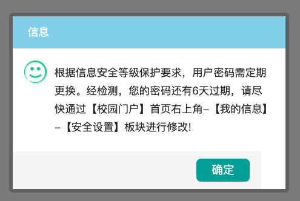
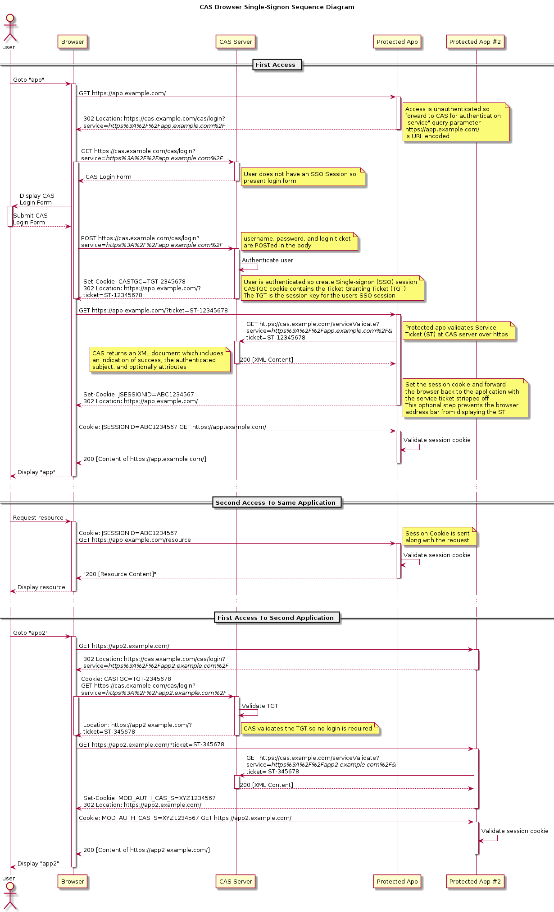
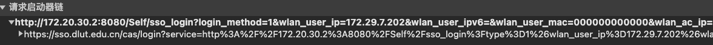
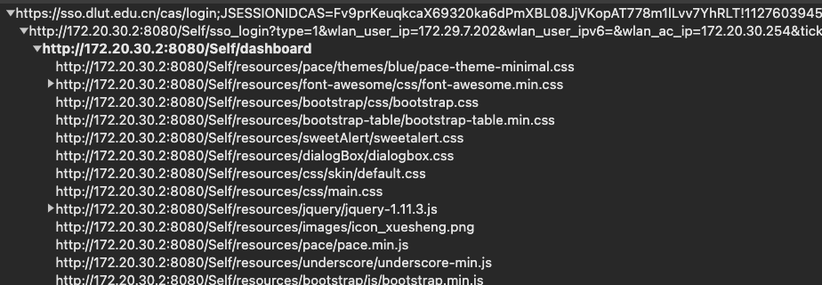
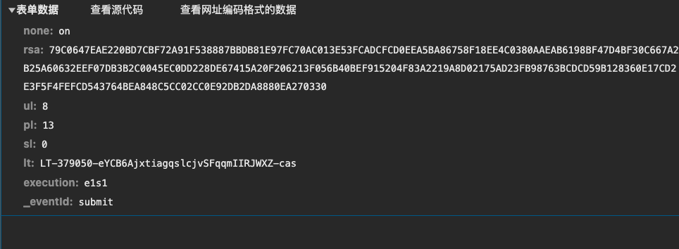
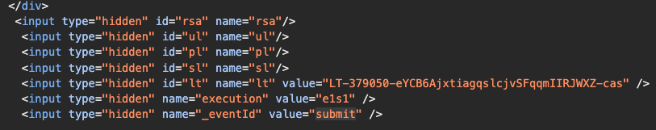
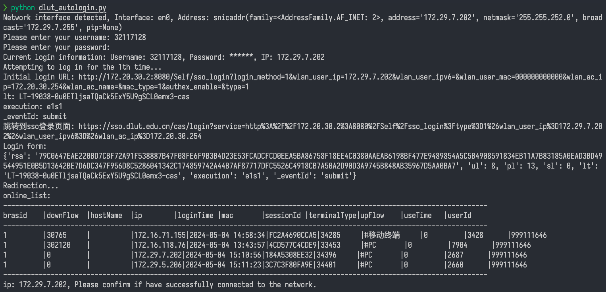

# DLUT_auto_login
## 适用于大连理工大学软件学院的校园网登录python脚本
- 由于本人在纯终端的环境时登录校园网遇到问题，因此写了这个脚本，以方便在终端登录校园网
- 理论上来说，脚本的登录流程是适用校园网的SSO认证，因此在除校园网登录场景外的其他场景也能类似修改后使用
- 所需环境：python3，requirments.txt中的库 ~~(通过chatgpt已将`des.js`转为`des.py`，不再需要nodejs)~~
- 此脚本只在软件学院网络进行过测试，对于其他校区是否可用未进行测试
- 需要注意，在校园网提示密码需要更换时，可能脚本无法正确登录，如下图的场景
- 最后测试的可使用日期：2026.10.28

## 宇宙级免责声明
- 本脚本只是为了便于非图形化终端的用户登录校园网，没有对校园网有任何攻击行为，也不会泄漏用户个人信息
- 本项目不保证您在当下时间使用时可用，因为校园网的登录方式可能会发生变化
- 本人代码能力低下，分析校园网行为的能力也很弱，如果您对我的代码和校园网行为分析有任何不同意见，欢迎讨论
- 由于本人对python不甚了解，代码大量由chatgpt生成，因此可能存在一些不正确的地方，欢迎指正
- 本项目仅供个人学习交流使用

## 使用方法

### 初始化环境与本地配置（Windows）

```powershell
python -m venv .venv
.\.venv\Scripts\python.exe -m pip install -r requirements.txt
Copy-Item config.example.json config.local.json
Copy-Item dlut_cookies.example.json dlut_cookies.json
```

在 `config.local.json` 中填写 `username`（学号）和 `password`（密码）。
`cookies_file` 指向 Cookie JSON 文件，相对路径以配置文件所在目录为准。
这两个本地文件含敏感信息，已被 Git 忽略；提交到仓库的 `.example.json` 只含占位符。
已有本地文件时无需重新复制模板，以免覆盖已填写的内容。

如果统一身份认证要求短信二次验证，先在 Edge 中完成认证，然后把
`sso.dlut.edu.cn` 域名下的 `JSESSIONIDCAS`、`devInfo` 的实际内容填入
`dlut_cookies.json`（如有 `TGC` 也可作为同名字段加入）。脚本仅把这些 Cookie
发送给 SSO 域名，路径为 `/`。Cookie 失效时需重新认证并更新本地文件。
不使用 Cookie 时，从配置中删除 `cookies_file` 字段或设为空字符串。

### 单次登录

```powershell
.\.venv\Scripts\python.exe .\dlut_autologin.py
```

默认读取脚本目录的 `config.local.json`；也可通过 `--config` 指定其他 JSON 文件。
命令行的 `-u`、`-p`、`--cookies` 优先于配置文件。`--cookies` 的相对路径以当前工作目录为准。
未提供账户或密码时会交互询问，密码输入不回显；推荐使用本地配置，避免把密码写入命令历史。
`-i IP` 可指定校园网 IPv4，不指定时自动检测网卡。

```powershell
.\.venv\Scripts\python.exe .\dlut_autologin.py --config .\config.local.json -i 172.29.0.100
```

登录成功以进入校园网自助服务首页为准；需要短信二次认证时会明确提示。

### 自动重连

```powershell
pwsh -File .\auto_boost.ps1
```

需要 PowerShell 7。脚本使用项目内的 `.venv`、`config.local.json`，不再包含账号、密码或机器绝对路径。
每次重连会释放并重新获取网卡地址，导致短暂断网；失败后每隔 30 秒重试，成功后每隔 2 分钟检测网络。
检测时，三个目标中至少一个 Ping 成功即视为连通，全部失败时重新连接。
按 `Ctrl+C` 停止。

### 本地验证（不访问校园网、不重置网卡）

```powershell
.\.venv\Scripts\python.exe -m unittest discover -s tests -v
```

## 校园网行为分析

- 初始访问校园网登录网址"http://172.20.30.2:8080/Self/sso_login?login_method=1&wlan_user_ip={ip}&wlan_user_ipv6=&wlan_user_mac=000000000000&wlan_ac_ip=172.20.30.254&wlan_ac_name=&mac_type=1&authex_enable=&type=1"
- 其中的IP地址为当前设备的校园网IP地址，登录时需要将其替换为当前设备的IP地址，因为校园网在未登录时已获取IP，设备可通过`ipconfig/ifconfig/ip addr show`等命令获取
- 之后会重定向，进行SSO认证（单点登录（英语：Single sign-on，缩写为 SSO），又译为单一签入，一种对于许多相互关连，但是又是各自独立的软件系统，提供访问控制的属性。当拥有这项属性时，当用户登录时，就可以获取所有系统的访问权限，不用对每个单一系统都逐一登录。这项功能通常是以轻型目录访问协议（LDAP）来实现，在服务器上会将用户信息存储到LDAP数据库中。相同的，单一退出（single sign-off）就是指，只需要单一的退出动作，就可以结束对于多个系统的访问权限 [^1]）
- 校园网通过CAS进行SSO认证，下图为CAS流程示意图[^2]

- 成功SSO认证后会重定向进入"http://172.20.30.2:8080/Self/dashboard"页面，并通过"http://172.20.30.2:8080/Self/dashboard/getOnlineList"获取在线设备列表

- 校园网的实际登录流程如下



  - 登录时post的参数为
  - 登录的js代码为"https://sso.dlut.edu.cn/cas/comm/js/login6.js?v=20230918"中的`login`函数，如下所示
    ``` javascript
    function login(){
        
        var $u = $("#un") , $p=$("#pd");
        
        var u = $u.val().trim();
        if(u==""){
            $u.focus();
            $("#errormsg").text("账号不能为空。");
            $("#help-link").hide();
            return ;
        }
        
        var p = $p.val().trim();
        if(p==""){
            $p.focus();
            $("#errormsg").text("密码不能为空。");
            $("#help-link").hide();
            return ;
        }
        
        $u.attr("disabled","disabled");
        $p.attr("disabled","disabled");
        
        var lt = $("#lt").val();
        
        $("#ul").val(u.length);
        $("#pl").val(p.length);
        $("#sl").val(0);
        $("#rsa").val(strEnc(u+p+lt , '1' , '2' , '3'));
        
        $("#loginForm")[0].submit();
    }
    ```
    ~~以固定的'1' '2' '3'作为密钥加密不理解😅~~

    其中的加密函数`strEnc`在"https://sso.dlut.edu.cn/cas/comm/js/des.js?v=20211211"

    剩余的一些参数在登录页面被隐藏，如下图所示
    

- 通过分析，可以得到登录的大致流程，因此可以用python模拟整个过程，加密函数文件des.js文件已由chatgpt转为des.py，取消了对nodejs的需求(~~其中需要注意的是需要通过额外调用des.js的加密函数进行加密，因此需要将des.js下载到本地，这里通过使用nodejs执行并获取结果，因此本地需要安装nodejs~~)
- 为了更加无脑的使用脚本，而节省手动查询设备IP的过程，脚本中通过遍历所有网络接口获取每个网络接口的IP，由于校园网的IP地址以"172"开头，因此脚本通过此判断是否为校园网IP（这在多网卡设备是否出错并未测试）
- 为了防止在不支持中文的终端中使用会乱码，终端的打印log都是英文

## 运行结果
运行成功后会输出如下结果


[^1]: https://zh.wikipedia.org/zh-cn/%E5%96%AE%E4%B8%80%E7%99%BB%E5%85%A5

[^2]: https://apereo.github.io/cas/6.6.x/protocol/CAS-Protocol.html


